<picture>
  <source media="(prefers-color-scheme: dark)" srcset="./banner-dark.svg">
  <source media="(prefers-color-scheme: light)" srcset="./banner-light.svg">
  
</picture>

### Hi, I'm Arun 👋

I build Android apps with **Kotlin** and **Jetpack Compose**: location tracking, real-time device monitoring over MQTT, and offline-first storage with Realm.

**What I've been building**

- [**Location-Tracker**](https://github.com/Arunkanagu/Location-Tracker): live GPS tracking backed by Realm
- [**MQTT-Monitor**](https://github.com/Arunkanagu/MQTT-Monitor): watching MQTT topics from an Android app
- [**dietively**](https://github.com/Arunkanagu/dietively): a diet companion app
- [**ComposePrefs**](https://github.com/Arunkanagu/ComposePrefs): preference screens for Jetpack Compose (fork)
